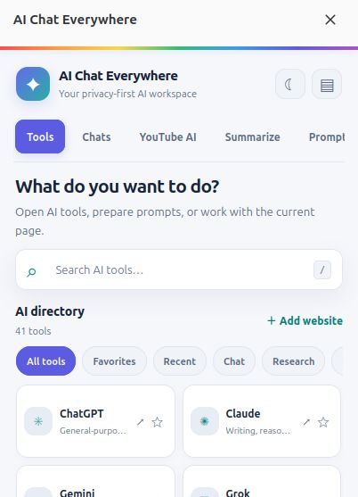

  
  <h1>AI Chat Everywhere</h1>
  
<strong>Your AI workspace, built into Firefox.</strong>

  
Find AI tools, organize AI conversations, prepare YouTube-to-Gemini workflows, and use contextual text actions — without provider API keys.

  

    <a href="https://addons.mozilla.org/en-US/firefox/addon/chatgpt-everywhere/"><strong>Get it for Firefox</strong></a>
    ·
    <a href="https://github.com/khzg/ChatGPT"><strong>Source code</strong></a>
    ·
    <a href="https://github.com/khzg/ChatGPT/issues"><strong>Report an issue / Suggest an AI tool</strong></a>
  

  

    
    
    
    
  

---

## Why AI Chat Everywhere?

AI tools are spread across dozens of websites. AI Chat Everywhere brings frequently used services and practical AI workflows into one lightweight Firefox extension.

Use it as a directory for AI websites, a local conversation manager, a YouTube-to-Gemini assistant, a prompt library, and a local research notebook. AI websites can open in a new tab or, when supported, in Firefox's Sidebar. Right-click actions are prepared inside the extension Sidebar without opening a new tab.

**No OpenAI, Anthropic, Google, or other provider API key or separate AI Chat Everywhere account is required.** The extension prepares and organizes content; you use the providers' own websites, and may need an account with the provider you choose.

## Features

### 🔎 One searchable AI directory

- A curated directory of **41 AI destinations**.
- Categories include Chat, Research, Documents, Coding, Agents, Images, Audio, and Video.
- Search by tool name, category, or description.
- Favorites and recently used tools.
- Add your own AI websites using a simple name and URL.
- New-tab opening is the default. Sidebar opening is an optional setting.

The built-in directory includes services such as ChatGPT, Claude, Gemini, Grok, Microsoft Copilot, DeepSeek, Perplexity, NotebookLM, Cursor, GitHub Copilot, Midjourney, Adobe Firefly, Suno, Runway, and more. Availability, features, and free tiers are controlled by each provider and may change independently of this extension.

### 🧾 Page summary assistant

- Read the active page only after you click the page-reading action.
- Prepare a reusable summary prompt in the extension window.
- The default instruction first asks the AI which language you want, waits for your answer, and only then asks it to summarize.
- Copy the prompt or open your preferred AI website.
- Paste text manually when Firefox cannot read a protected page.

The extension does **not** generate an AI summary on its own. It prepares the prompt for the AI provider you choose.

### ✍️ Prompt Studio

- **112 built-in prompt templates:** 41 free and 71 included with Complete Pro.
- Search prompts and filter by category.
- Browse the library in small pages instead of rendering the entire collection at once.
- Save your own reusable prompts locally.
- Edit and copy a prompt before using it.
- Use variable-based templates in Prompt Studio Pro.
- Import and export your personal prompt collection with JSON files in Complete Pro.

Prompt categories cover areas such as writing, research, coding, marketing, learning, business, product, operations, analysis, and productivity.

### ⇄ Multi-Chat Pro

- Choose two or more supported chat providers.
- Enter one question or prompt.
- Open the selected providers in separate tabs with one action.
- Copy the shared prompt once, then paste it into each provider yourself.

**Important:** Multi-Chat does not silently fill in or submit forms on third-party websites. You stay in control of what is sent to each provider.

### 📚 Web Research Pro

- Create local research projects.
- Save readable text from the active browser tab after an explicit click.
- Organize collected pages by project.
- Remove individual sources when they are no longer useful.
- Create a research-analysis prompt grounded in the collected sources.
- Export a project as Markdown or back it up as JSON.
- Import a JSON backup without replacing existing projects.

To keep the extension lightweight and predictable, the current implementation applies these limits:

- Up to 25 research projects.
- Up to 20 sources per project.
- Up to 9,000 characters captured per research source.
- Import/export files are limited to 5 MB.

### 🗂️ Conversation Manager (Free)

- Save the currently open conversation from supported AI websites such as ChatGPT, Claude, Gemini, Grok, Copilot, DeepSeek, and Perplexity when the messages are visible.
- - Organize saved conversations with folders and comma-separated tags.
- Search saved titles, message text, providers, and tags.
- Pin, archive, restore, rename, open, and delete conversations.
- Export the local conversation library as JSON.
- Conversation data stays in Firefox local extension storage.

**History reminder:** chat history must be enabled on each provider. Depending on the provider and its settings, a conversation may only remain available for around 6 or 18 months. The extension can only save conversations that are still available to the page when you save them; it cannot restore provider history that has been deleted or is no longer retained.

### ▶️ YouTube AI (Free)

- Open a YouTube video and select **YouTube AI** in the extension.
- YouTube AI detects the active video, asks for your preferred language, and prepares a Gemini prompt with the video URL.
- It prepares a prompt for Gemini to inspect that exact link, explain which video actions it can genuinely perform in the current session, and ask you to choose one.
- Copy the prompt or open Gemini. No subtitles are extracted and no AI API is used by the extension.

### 🖱️ Smart selection context menu (Free)

Select text on a webpage and right-click to prepare a summary, translation, explanation, rewrite, grammar correction, simplified version, key points, questions, or a custom AI question. The result appears in the extension Sidebar. These actions do not open a browser tab and only prepare a prompt; you choose when and where to submit it.

### 🎨 Everyday usability

- Light theme by default, with an optional dark theme.
- Keyboard shortcut: `Alt + Shift + A` (the shortcut can be changed in Firefox's extension shortcut settings).
- Custom AI websites, favorites, and recent tools.
- Local preferences and prompt storage.
- Lightweight prompt pagination and bounded research captures.

## Free vs. Complete Pro

| Capability | Free | Complete Pro |
|---|:---:|:---:|
| Browse and search the AI directory | ✓ | ✓ |
| Open providers in a new tab or optional Sidebar | ✓ | ✓ |
| Favorites, recent tools, and custom websites | ✓ | ✓ |
| Prepare page-summary prompts | ✓ | ✓ |
| Smart right-click selection actions in the extension Sidebar | ✓ | ✓ |
| YouTube AI link-to-Gemini workflow | ✓ | ✓ |
| Conversation Manager: save, organize, search, pin, archive | ✓ | ✓ |
| Export the local conversation library | ✓ | ✓ |
| Use the free prompt collection | ✓ | ✓ |
| Save personal prompts on this device | ✓ | ✓ |
| Premium prompt collection and variable templates | — | ✓ |
| Personal prompt JSON import/export | — | ✓ |
| Multi-Chat workspace | — | ✓ |
| Web Research projects and source collection | — | ✓ |
| Research backup import/export | — | ✓ |

**Complete Pro access: $4 for 3 months.** The free Conversation Manager, YouTube AI workflow, and smart right-click actions are not part of the Pro paywall.

### How Complete Pro activation works

1. Open the **Pro** area in the extension.
2. Use the purchase button to contact the publisher on Telegram. The current access period is 3 months.
3. After payment, the publisher provides a signed activation code for the purchased period.
4. Paste the code into the extension and select **Activate**.

License verification happens locally in the extension. No license-server API is used. The public extension contains the public verification key; the private signing key must remain with the publisher and must never be committed to this repository or shared with customers.

**Offline-license limitation:** because activation is offline, a code can be transferred to another person and cannot be remotely revoked. Time-limited codes are checked locally and should not be treated as tamper-proof DRM.

## Install

### Install from Firefox Add-ons

The public store listing is here:

**[AI Chat Everywhere on Firefox Add-ons](https://addons.mozilla.org/en-US/firefox/addon/chatgpt-everywhere/)**

After installation, pin the extension to the Firefox toolbar for quick access.

### Temporary installation for development

1. Download or clone this repository.
2. Open Firefox and navigate to `about:debugging#/runtime/this-firefox`.
3. Select **Load Temporary Add-on…**.
4. Choose the `manifest.json` file from the extension folder.
5. Open the extension from the toolbar to explore its workspaces.

The manifest declares Firefox 109 as the minimum supported version. Some websites or browser-protected pages may behave differently depending on the provider and Firefox version.

## Quick start

1. **Find a tool:** open the extension, search for a provider, and select it.
2. **Choose where it opens:** by default, providers open in a new tab. Enable **Open AI websites in Firefox Sidebar** only if you prefer the Sidebar experience.
3. **Summarize a page:** open the Summarize area, choose **Read current browser tab**, copy the prepared prompt, open an AI provider, and paste it into the chat.
4. **Use a prompt:** open Prompt Studio, search or choose a category, select a prompt, fill in any variables, and copy it.
5. **Compare assistants:** with Complete Pro active, enter a prompt in Multi-Chat, select at least two providers, and launch the chats. Paste the copied prompt into each provider.
6. **Build a research collection:** with Complete Pro active, create a project, visit a normal webpage, and select **Save current page to project**.
7. **Organize chats:** open the Chats area to save, search, folder, tag, pin, archive, rename, and delete conversations locally. Export your library as JSON for backup.
8. **Work with a YouTube video:** open the video, choose **YouTube AI**, select your language, then copy the prepared prompt or open Gemini. No video-link copy button is shown; the link is included in the prepared prompt.

## Privacy and data handling

AI Chat Everywhere is designed to keep extension workflows local-first:

- No AI provider API keys are needed.
- The extension does not send page text, saved conversations, prompts, research notes, or personal prompt collections to an extension-operated server.
- Page text is read only after the user explicitly requests a page-reading or save action.
- Favorites, settings, custom services, personal prompts, research projects, saved conversations, and the activation code are stored using Firefox local extension storage.
- Prompt, research, and conversation-library exports are generated locally in the browser. Imports use the file picker and are validated before being added.
- The extension does not request browsing-history access or the Downloads permission.
- The extension does not silently submit prompts to AI websites.

When you manually paste content into an AI provider, that provider receives the content and its own privacy policy and terms apply. Review the provider's policies before sharing confidential, personal, or regulated information.

### Browser permissions

| Permission | Why it is used |
|---|---|
| `storage` | Save preferences, favorites, custom tools, prompts, local research projects, saved conversations, and license data. |
| `unlimitedStorage` | Allow larger local conversation libraries and research collections. |
| `menus` | Add the selection actions to the browser's right-click menu. |
| `activeTab` | Allow a user-requested action on the active tab. |
| `scripting` | Read visible page text after the user clicks a supported page-reading action. |
| `clipboardWrite` | Copy prompts and research briefs when requested. |

The extension does not request broad access to all website data, browsing history, or the Downloads API.

## Known limitations

- AI providers are external websites. Their availability, login requirements, free quotas, regional access, and interface can change without notice.
- Some sites may not work well in a narrow Firefox Sidebar. Turn off the Sidebar option to open those providers in a normal tab.
- Firefox restricts extensions from reading certain pages, including browser-internal pages and some protected documents. You can paste text manually when page extraction is unavailable.
- The Conversation Manager saves the currently visible chat; it does not log in to providers or automatically retrieve every historical conversation.
- Site DOM changes can affect current-chat extraction. If a page does not expose readable messages, use the provider chat normally and try saving again when the messages are visible.
- Multi-Chat opens provider tabs and copies your prompt; manual paste is required for each provider.
- Summarization, YouTube video analysis, and research synthesis are performed by the AI provider after you submit the prepared prompt, not by an embedded AI model in this extension.

## Suggest an AI tool or report a problem

Useful community suggestions help keep the directory relevant. Before suggesting a service, please check that it:

1. Has an official, stable HTTPS website.
2. Provides a useful and reasonably user-friendly experience.
3. Offers a free plan, free trial, or meaningful free daily allowance (when applicable).
4. Clearly explains its privacy terms and account requirements.

When opening an issue, include the official website, the category, what makes it useful, and any access limitations you have noticed.

- **Issues and suggestions:** [GitHub Issues](https://github.com/khzg/ChatGPT/issues)
- **Project repository:** [khzg/ChatGPT](https://github.com/khzg/ChatGPT)
- **Firefox listing:** [AI Chat Everywhere](https://addons.mozilla.org/en-US/firefox/addon/chatgpt-everywhere/)

## Contributing

Contributions, bug reports, documentation improvements, and high-quality AI tool suggestions are welcome. Please keep changes focused and explain how they were tested. For UI changes, include before/after screenshots when possible. For browser API changes, document the required permissions and why they are necessary.

Please do not include private activation issuers, private signing keys, customer activation codes, personal data, or browser profile files in commits, issues, or pull requests.

## Publisher setup

Before distributing a build, update `config.js`:

- Verify the configured `telegramUsername` and keep the displayed price label accurate. The current configuration is `$4 / 3 months`.
- Keep the Firefox Add-ons and GitHub links accurate.

Never place the private license issuer or its signing key in the public repository, the extension package, or a public release. Keep a secure offline backup of the issuer.

---

  <strong>Enjoying AI Chat Everywhere?</strong> 
  Share the extension with someone who works with AI tools, and leave an honest review on Firefox Add-ons after trying it.

## ❤️ Support

please share with followers.

💝 donation($5 or more).

(USDT BEP20): 0x2A4eE50b2bf51c38Fe66120695976be493FcE8fF
